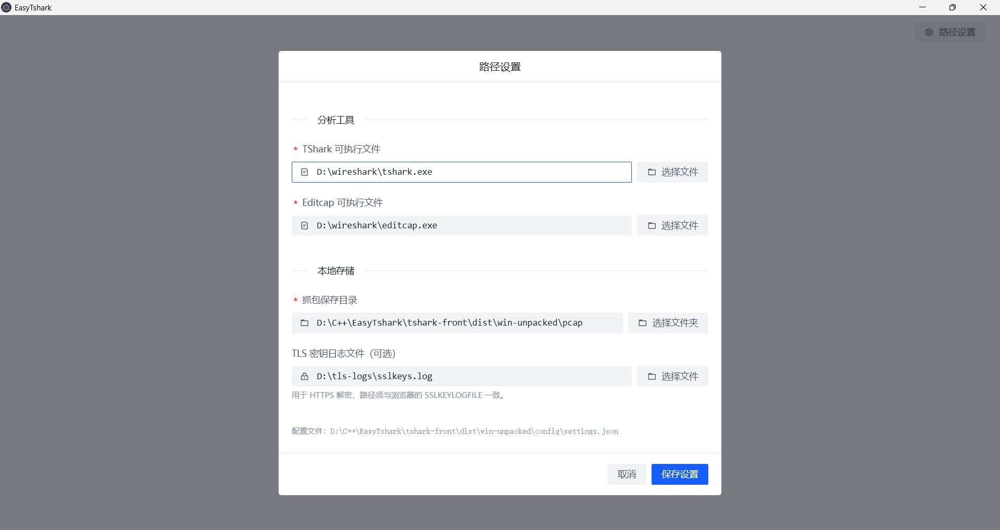
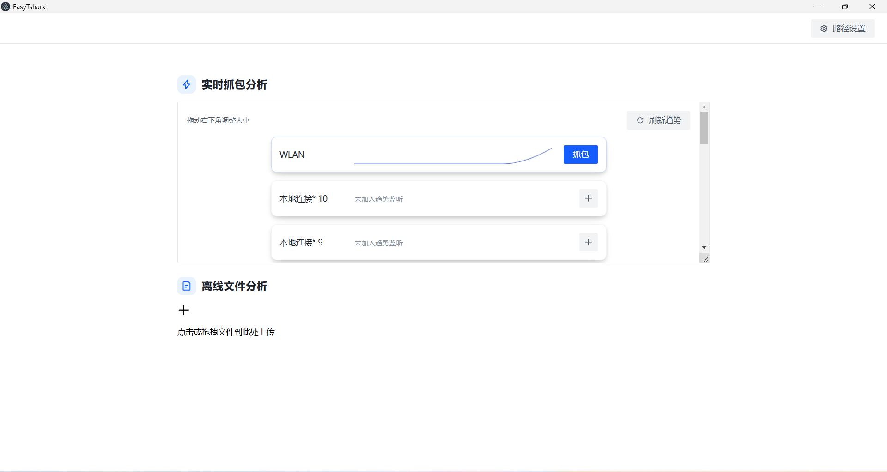
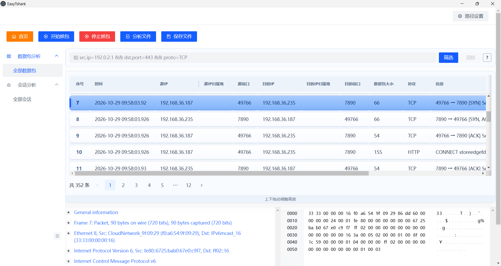
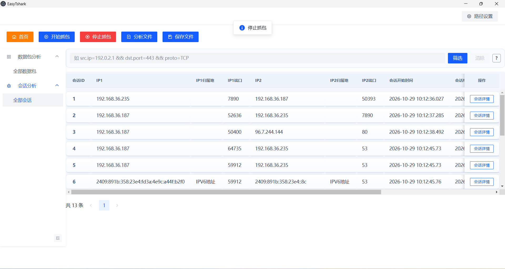
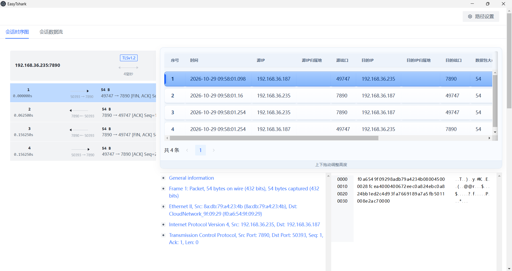

# EasyTshark

## 运行环境

- Windows 10/11
- Visual Studio 2022 + `v143`
- Node.js 18+ 和 npm
- 安装 Wireshark，确保 `tshark.exe` 和 `editcap.exe` 可用

## 依赖准备

这个仓库里有些内容是本地依赖，不会随 Git 一起提交：

- `third_library/`
- `tshark-front/node_modules/`
- `logs/`
- `pcap/`
- `*.db`
- `ip2region.xdb`

拉取仓库后，先把这些依赖补齐。

### 1. 后端第三方库

确保根目录下存在 `third_library/`，并包含项目要用到的头文件和源码，至少要有：

- `third_library/httplib`
- `third_library/ip2region/`
- `third_library/rapidjson/`
- `third_library/spdlog/`
- `third_library/sqlite3/`

同时保证 `third_library/ip2region/ip2region.xdb` 存在。

### 2. TShark

安装 Wireshark 后，在前端“路径设置”中分别选择安装目录内的 `tshark.exe` 和 `editcap.exe`。后端不再查找写死的工具路径；请保留 Wireshark 安装目录内的 DLL 等依赖，不要只复制两个 exe。

### 3. 前端依赖

进入 `tshark-front/` 执行：

```bash
npm install
```

构建产物会输出到 `tshark-front/build/`，Electron 运行时会直接读取这里。

## 启动顺序

1. 打开 `EasyTshark.sln`
2. 先确认 `third_library/` 已补齐，并安装 Wireshark
3. 编译后端 C++ 项目
4. 进入 `tshark-front/` 执行 `npm install`
5. 启动后端程序，监听 `127.0.0.1:8080`
6. 前端开发模式执行：

```bash
npm start
```

7. 如需 Electron 壳，再开一个终端执行：

```bash
npm run electron-dev
```

前端默认连的是 `http://127.0.0.1:8080`，Electron 开发模式会走 `http://localhost:3000`

首次打开前端后，按提示完成路径设置。

## 打包

Windows 安装包允许选择盘符根目录或任意文件夹，并在该目录后自动追加 `EasyTshark`：选择 `D:\` 时安装到 `D:\EasyTshark`，选择 `D:\1\` 时安装到 `D:\1\EasyTshark`。浏览选择与手动输入遵循相同规则；末级目录已名为 `EasyTshark` 时不重复追加，父级目录包含该名称不影响追加。安装器源文件位于 `tshark-front/installer/`，不放在会被前端构建清空的 `build/` 中。卸载和升级仅删除打包时记录的程序文件，并尝试移除空目录，不递归删除安装目录；配置、抓包及其他用户文件会保留。

```bash
npm run build
npm run electron-build
```

## 运行结果

启动后会生成或使用这些本地文件/目录：

- `logs/log.txt`
- 设置中指定的抓包保存目录
- `config/settings.json`（源码项目根目录；安装版为主程序安装目录）
- `myPacketDatabase.db`

这些都不需要提交到仓库。

## 功能展示

首次启动应用程序时，会弹出路径配置窗口，需要配置wireshark相关组件的路径，如果需要对HTTPS流量进行解密，需要设置环境变量SSLKEYLOGFILE，并将TLS密钥日志文件一项设置环境变量的值。




完成路径配置后，会看到流量趋势窗口，根据需求选择网卡之后并刷新会开始渲染指定网卡的流量趋势折线图，添加的网卡会保存在配置文件中。已添加网卡旁的减号按钮可将其移出趋势监听并保存配置；移除后自动刷新监听，移除全部网卡后停止趋势轮询。该界面同时提供了离线文件分析入口。

会话列表自动轮询更新，每次请求完成后等待 1 秒再刷新，保留当前分页、筛选条件及选中会话；离开页面后停止轮询，分页或筛选切换前的旧响应不会覆盖新列表。



点击”抓包“按钮，可开始对执行网卡实时抓包，可以查看所有会话以及数据包，界面提供了简易的筛选功能






