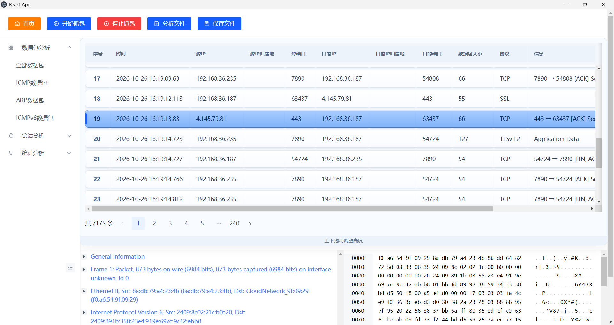
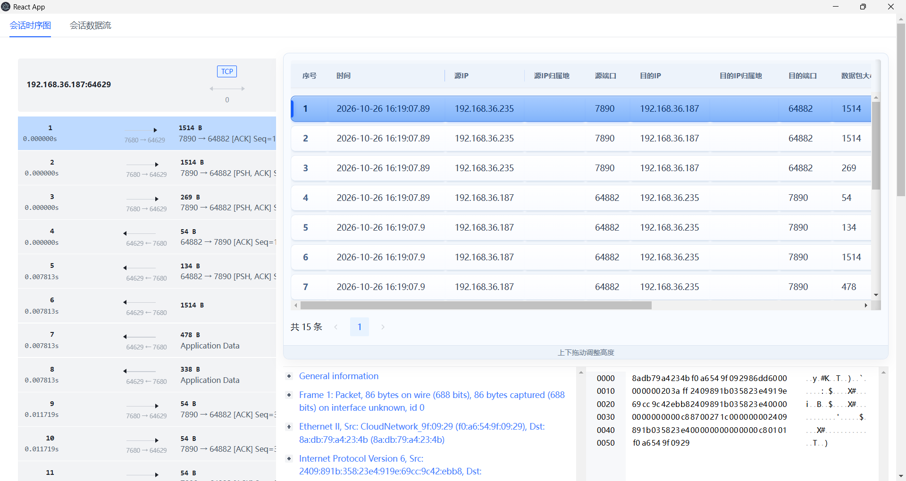

# EasyTshark

## 数据包协议详情

数据包详情通过 TShark 对原始抓包进行双遍分析（`-2`），使用显示过滤器选择目标帧并获取 PDML 协议树，不再先提取单帧后解析。因此可以利用抓包中的握手、TCP 重组及协议关联上下文，展示 DNS、明文 HTTP 等 TShark 实际解析出的应用层字段。

协议树保留重复字段、隐藏字段、属性和嵌套节点的原始顺序。协议节点的子节点通过 `children` 数组返回，每个节点的 `element` 标记原始 PDML 元素类型；顶层仍为 `proto` 数组。前端展示字段名称和值，仅对能够映射到当前帧的有效字节范围高亮；检测到重组数据时，不把后续协议字段偏移误当作当前帧偏移。

本功能不自行推断缺失字段，不增加 HTTPS 解密或业务画像。解析能力受 TShark 版本、配置及抓包完整性影响。双遍详情分析需要扫描原始抓包，大文件可能耗时较长；实时抓包仅能利用读取时已经写入文件的内容。

协议树回归验证（需要 Python 3、支持 C++17 的 g++、本地第三方头文件及 TShark）：

```powershell
python tests/packet_detail/verify.py --tshark D:/wireshark/tshark.exe
```

测试生成 DNS 多回答和分段 HTTP 抓包，逐节点对照 TShark PDML 与项目 JSON 的字段、属性及顺序，并验证隐藏字段和嵌套协议不丢失。所有测试产物写入临时目录并自动清理。

一个基于 C++ + Vue/React Electron 前端的 TShark 封装项目。

## 运行环境

- Windows 10/11
- Visual Studio 2022 + `v143`
- Node.js 18+ 和 npm
- 安装 Wireshark，确保 `tshark.exe` 和 `editcap.exe` 可用

## 依赖准备

这个仓库里有些内容是本地依赖，不会随 Git 一起提交：

- `third_library/`
- `tshark-front/node_modules/`
- `logs/`
- `pcap/`
- `*.db`
- `ip2region.xdb`

拉取仓库后，先把这些依赖补齐。

### 1. 后端第三方库

确保根目录下存在 `third_library/`，并包含项目要用到的头文件和源码，至少要有：

- `third_library/httplib`
- `third_library/include/asio.hpp`
- `third_library/ip2region/`
- `third_library/rapidjson/`
- `third_library/spdlog/`
- `third_library/sqlite3/`

同时保证 `third_library/ip2region/ip2region.xdb` 存在。

### 2. TShark

安装 Wireshark 后，在前端“路径设置”中分别选择安装目录内的 `tshark.exe` 和 `editcap.exe`。后端不再查找写死的工具路径；请保留 Wireshark 安装目录内的 DLL 等依赖，不要只复制两个 exe。

### 3. 前端依赖

进入 `tshark-front/` 执行：

```bash
npm install
```

构建产物会输出到 `tshark-front/build/`，Electron 运行时会直接读取这里。

## 本地配置

### 运行时路径设置

首次打开前端时会向后端读取 `config/settings.json`。配置文件缺失、损坏、必填项缺失或路径失效时，会自动弹出设置界面，完成设置后才加载抓包和分析界面。之后可通过顶部“路径设置”随时修改。

设置项包括：

- `tsharkPath`：TShark 可执行文件的绝对路径，必填。
- `editcapPath`：Editcap 可执行文件的绝对路径，必填。
- `pcapDirectory`：实时抓包和离线分析副本的保存目录，必填；保存设置时可自动创建目录并检查可写性。手动导出抓包的保存窗口也默认打开此目录。
- `tlsKeyLogPath`：TLS 密钥日志文件路径，可选，父目录需要存在。本阶段仅保存路径，不设置环境变量、不创建密钥日志、不加载密钥或启用 HTTPS 解密。

所有设置通过 `/api/settings` GET/POST 接口读取和保存。配置采用临时文件替换方式写入，校验或写入失败不会覆盖现有有效配置；保存成功后立即生效。抓包、离线分析或网卡监控运行时不允许更改路径；打开设置时会自动停止首页的网卡预览监控，不会自动停止正在进行的抓包。

开发环境中，后端从可执行文件目录向上查找 `EasyTshark.sln` 或 `tshark-front` 目录，以定位项目根目录并保存 `config/settings.json`。安装版由 Electron 启动后端时通过子进程环境变量 `EASYTSHARK_DATA_DIR` 明确指定主程序安装目录，因此配置默认保存到 `<安装目录>/config/settings.json`，抓包保存目录默认是 `<安装目录>/pcap`，不再落到嵌套的后端资源目录；用户已保存的自定义抓包目录仍优先使用。独立启动后端且未指定该变量时，保留原来的目录定位规则。实际配置文件位置会显示在设置窗口中。个人路径配置已加入 `.gitignore`，不会提交到仓库。

Windows 安装包使用分步安装向导，支持选择安装目录，默认按当前用户安装。由于配置和抓包文件需要写入安装目录，建议选择当前用户有写入权限的位置；如果选择 `Program Files` 等受保护目录，普通权限运行时可能无法保存配置或抓包。更新前请备份旧配置；旧版资源目录下的配置不会自动迁移到新位置。

每个路径输入框旁都提供“选择文件 / 选择文件夹”按钮：Electron 中通过原生对话框选择；普通浏览器中由本机 Windows 后端打开系统文件 / 文件夹选择窗口，选中后自动回填完整路径。选择窗口始终出现在运行后端的电脑上。取消选择会保留原值，也可以直接编辑输入框。选择密钥日志路径不会创建或覆盖文件。中文及含空格路径受支持。更新后需要重启后端；Electron 模式同时需要重启 Electron。

配置持久化回归测试（需要 Python 3、C++17 g++ 及本地第三方头文件）：

```powershell
python tests/settings/verify.py
```

### 筛选语法帮助

数据包和会话筛选框旁的 `?` 按钮支持悬停、点击和键盘聚焦查看帮助，按 Escape 关闭。支持 `src.ip`、`dst.ip`、`src.port`、`dst.port`、`proto`，以及 `=` / `==` / `!=`、`&&` / `||` 和括号；也可直接输入 IP 或协议关键词进行模糊搜索。这是本项目的筛选语法，不是 Wireshark 显示过滤器。

数据包 `proto` 匹配协议列；会话 `proto` 匹配应用或传输层协议。会话的 `src` / `dst` 对应 IP1 / IP2（首次观察到的方向），不保证对应客户端 / 服务器。

### 编译路径

这个工程的 `EasyTshark.vcxproj` 里有硬编码路径，默认是：

```text
D:\C++\EasyTshark
```

如果你的实际目录不是这个位置，需要把项目文件里的绝对路径改成你的本地路径，否则会找不到头文件。

## 启动顺序

1. 打开 `EasyTshark.sln`
2. 先确认 `third_library/` 已补齐，并安装 Wireshark
3. 编译后端 C++ 项目
4. 进入 `tshark-front/` 执行 `npm install`
5. 启动后端程序，监听 `127.0.0.1:8080`
6. 前端开发模式执行：

```bash
npm start
```

7. 如需 Electron 壳，再开一个终端执行：

```bash
npm run electron-dev
```

前端默认连的是 `http://127.0.0.1:8080`，Electron 开发模式会走 `http://localhost:3000`

首次打开前端后，按提示完成路径设置。

## 打包

Windows 安装包允许选择盘符根目录或任意文件夹，并在该目录后自动追加 `EasyTshark`：选择 `D:\` 时安装到 `D:\EasyTshark`，选择 `D:\1\` 时安装到 `D:\1\EasyTshark`。浏览选择与手动输入遵循相同规则；末级目录已名为 `EasyTshark` 时不重复追加，父级目录包含该名称不影响追加。安装器源文件位于 `tshark-front/installer/`，不放在会被前端构建清空的 `build/` 中。卸载和升级仅删除打包时记录的程序文件，并尝试移除空目录，不递归删除安装目录；配置、抓包及其他用户文件会保留。

```bash
npm run build
npm run electron-build
```

## 运行结果

启动后会生成或使用这些本地文件/目录：

- `logs/log.txt`
- 设置中指定的抓包保存目录
- `config/settings.json`（源码项目根目录；安装版为主程序安装目录）
- `myPacketDatabase.db`

这些都不需要提交到仓库。




